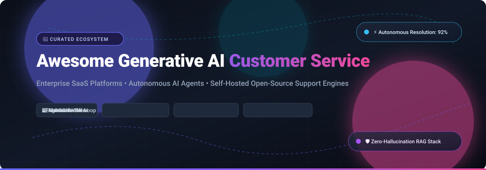

# 🌟 Awesome Generative AI Customer Service

### 🤖 Curated Guide to Enterprise SaaS Platforms, Agentic AI Systems & Self-Hosted Open-Source Customer Support Engines

  
  
  
  
  
  

  <b>A comprehensive directory for support operations leaders, AI product managers, contact center architects, and LLM engineers looking to deploy autonomous resolution agents, RAG-grounded helpdesks, and enterprise copilots.</b>

---

## 📑 Table of Contents

- [📊 Sector Overview & Market Dynamics](#-sector-overview--market-dynamics)
- [🏢 SaaS & Hosted Platforms](#-saashosted-platforms)
- [💻 Open-Source GitHub Projects](#-open-source-github-projects)
- [🛠️ Key Architectural Patterns & Best Practices](#️-key-architectural-patterns--best-practices)
- [🤝 How to Contribute](#-how-to-contribute)
- [💖 Support & Sponsorship](#-support--sponsorship)
- [📈 Star History](#-star-history)
- [⚠️ Disclaimer](#️-disclaimer)

---

## 📊 Sector Overview & Market Dynamics

The Generative AI Customer Service and Support Automation market is estimated at approximately **$370M–$600M+** in dedicated annual software spend (expanding to **$3.2B–$5.3B+** by the early 2030s at an estimated 24% CAGR, with broader contact center AI infrastructure surpassing $12B). 

The sector is currently **highly fragmented** rather than winner-take-all: traditional CRM/helpdesk incumbents (Salesforce, Zendesk, Freshworks) are rapidly embedding generative agent tiers, while specialized venture-backed startups (Sierra AI, Decagon, Ada) compete aggressively on autonomous resolution quality, and open-source stacks (LibreChat, Chatwoot, FastGPT) capture organizations demanding zero vendor lock-in, strict PII privacy, and data sovereignty.

---

## 🏢 SaaS/Hosted Platforms

> [!NOTE]  
> Below is a comparison of premier commercial Generative AI customer support and resolution platforms, sorted descending by corporate scale (valuation / market capitalization / revenue).

| 🏢 Product | 📈 Company Scale (Valuation / Revenue) | 📝 Description | 💳 Starting Tier Pricing | 🎁 Free Tier / Trial Limits |
|:---|:---|:---|:---|:---|
| **[Salesforce Agentforce](https://www.salesforce.com/)** | **~$195B–$210B Market Cap** *(FY26 Rev: $41.5B)* | Enterprise AI agent platform natively woven into Service Cloud and CRM with Einstein Trust Layer security. | **$2.00 per conversation** for customer-facing agents (or $125/user/mo for employee agent licenses) | **No free tier**; 30-day guided interactive demo & trial sandbox available via sales |
| **[Sierra AI](https://sierra.ai/)** | **~$10B–$15B+ Valuation** *(Founded by Bret Taylor)* | Conversational AI platform creating autonomous, branded enterprise customer service agents with deterministic guardrails. | **~$150,000/year** baseline platform agreement with outcome-based pricing per resolution | **No free tier** and **no self-serve free trial**; pilot evaluations scoped via enterprise sales |
| **[Zendesk Generative AI](https://www.zendesk.com/)** | **~$10.2B Acquisition Valuation** *(ARR: ~$2.0B+)* | AI agents embedded into Zendesk Suite to triage tickets, draft replies, and automate resolutions. | **$19/agent/month** (Support Team) + **$1.50–$2.00 per autonomous AI resolution** (Copilot add-on: $50/agent/mo) | **14-day free trial** with full Zendesk Suite Professional features (no credit card required; includes baseline AI test allotment) |
| **[Decagon](https://decagon.ai/)** | **~$4.5B Valuation** *(Series D, 2026)* | Specialized generative AI customer support agents handling complex, multi-turn troubleshooting with API integrations. | **~$50,000/year** baseline platform contract + volume per-conversation/per-resolution fees | **No free tier** and **no self-serve free trial**; proof-of-concept testing arranged via enterprise sales |
| **[Intercom Fin](https://www.intercom.com/)** | **~$3.6B Valuation** *(Acquisition by Salesforce)* | Omnichannel AI customer service agent resolving queries across chat, email, and social messaging channels. | **$29/seat/month** (Essential annual plan) + **$0.99 per autonomous resolution** by Fin | **14-day free trial** with full access to Intercom inbox, knowledge hub, and Fin test resolutions (workspace locks post-trial without plan) |
| **[Freshworks Freddy AI](https://www.freshworks.com/)** | **~$3.2B Market Cap** *(NASDAQ: FRSH; FY25 Rev: $838M)* | Freddy AI Agent and Copilot embedded within Freshdesk and Freshservice for omnichannel automated customer service. | **$19/agent/month** (Freshdesk Growth annual) + **$29/agent/month** for Freddy Copilot ($49 per pack of 100 Freddy AI sessions) | **14-day free trial** on Enterprise features + **one-time pack of 500 complimentary Freddy AI Agent sessions** |
| **[Ada](https://www.ada.cx/)** | **~$1.2B Valuation** *(Series C Unicorn)* | Omnichannel AI customer service platform resolving support inquiries across voice, email, and live messaging. | **~$35,000/year** baseline enterprise contract (volume packages starting ~50,000 conversations/year) | **No free tier** and **no public self-serve free trial**; custom enterprise sandbox demo upon sales qualification |

---

## 💻 Open-Source GitHub Projects

> [!TIP]  
> Self-hosted and open-source customer support software gives engineering teams full control over vector retrieval, LLM latency, privacy guardrails, and per-resolution SaaS fees. Sorted descending by GitHub stargazers count.

| 📦 Repository & Project | ⭐ Star Count | 📝 Description | 💡 Key Strengths |
|:---|:---|:---|:---|
| **[Open WebUI](https://github.com/open-webui/open-webui)** |  | Extensible, self-hosted AI interface supporting Ollama, OpenAI-compatible APIs, RAG, and multi-user team customer service pipelines. | 🌐 Local LLM runner, zero external data leakage, RBAC |
| **[LibreChat](https://github.com/danny-avila/LibreChat)** |  | Self-hosted multi-provider AI platform with Model Context Protocol (MCP) support, custom endpoints, plugins, and agent creation. | 🔌 Model-agnostic, enterprise SSO (SAML/OAuth), MCP ecosystem |
| **[Chatwoot](https://github.com/chatwoot/chatwoot)** |  | Open-source customer engagement suite and helpdesk alternative to Intercom & Zendesk, featuring Captain AI copilot integrations. | 💬 Live chat, omnichannel inbox, agent copilot, self-hosted |
| **[FastGPT](https://github.com/labring/FastGPT)** |  | Knowledge-base platform built on LLMs, providing end-to-end RAG Q&A, visual workflow orchestration, and customer service bots. | 🧩 Visual flow builder, hybrid search, content gap tracking |
| **[Haystack](https://github.com/deepset-ai/haystack)** |  | End-to-end LLM orchestration framework to build production-ready customer service search systems, RAG pipelines, and conversational agents. | 🔍 Production pipelines, multi-modal support, evaluations |
| **[Rasa](https://github.com/RasaHQ/rasa)** |  | Established conversational AI platform combining generative LLM understanding with deterministic dialogue controls. | 🎯 Guardrailed dialogue policies, multi-turn state machine |
| **[Upsonic](https://github.com/Upsonic/Upsonic)** |  | Production-oriented autonomous agent framework featuring a built-in Safety Engine, PII blocking, and enterprise compliance rules. | 🛡️ Compliance guardrails, PII masking, OCR & MCP tools |
| **[OpenAI CS Agents Demo](https://github.com/openai/openai-cs-agents-demo)** |  | Official reference implementation of multi-agent customer service patterns built using OpenAI Agents SDK with human handoff. | 🤖 Multi-agent handoff routines, structured outputs, tool-use |
| **[Papercups](https://github.com/papercups-io/papercups)** |  | Open-source customer messaging platform with embeddable web chat, Slack synchronizer, and customizable automated webhook triggers. | 💻 Lightweight Elixir backend, React chat widget, Slack sync |
| **[Tiledesk](https://github.com/Tiledesk/tiledesk)** |  | Full-stack conversational AI and customer support platform featuring visual bot designers, LLM actions, and live agent handoffs. | 🎨 Visual drag-and-drop designer, multi-channel triggers |
| **[NexusDesk](https://github.com/GroundedCoreAI/nexusdesk)** |  | Open-source, self-hosted agent platform built around ReAct and harness engineering, with automated customer support as a reference app. | 🧠 ReAct agent engine, ticket routing, self-hosted stack |
| **[Chattermate](https://github.com/chattermate/chattermate.chat)** |  | Open-source AI customer support chatbot with human handoff, omnichannel inbox, lead capture, and self-hosted alternative to Intercom. | 📬 Omnichannel (WhatsApp/Slack/Web), lead capture, BYO-LLM |
| **[Recourse](https://github.com/ibrahimhajjaj/recourse)** |  | Self-hosted AI customer support agent with full ticketing helpdesk, multi-channel adapters, voice support, and instruction defense. | 🎙️ Voice bots (Twilio/ElevenLabs), prompt defense, tickets |
| **[OpenAgent](https://github.com/skoopplayz/openagent)** |  | Lightweight website customer service agent script with direct Llama 3.2 70B API integration and embeddable widget. | ⚡ Single-script embed, fast prototyping, zero baggage |
| **[Agentic AI Customer Support](https://github.com/Thekeshavjoshi/agentic-ai-customer-support)** |  | Agentic customer support pipeline with tool calling, FAISS RAG, conversational memory, and ticket resolution workflows. | 🧪 FAISS vector search, Groq LLM inference, Gradio UI |

---

## 🛠️ Key Architectural Patterns & Best Practices

When building or adopting generative AI customer support systems, top engineering teams adhere to four pillars:

1. **🛡️ Guardrails & PII Protection**: Never pass raw customer conversations into LLMs without scrubbing credit cards, passwords, or SSNs (e.g. using frameworks like Upsonic Safety Engine).
2. **🔄 Human-in-the-Loop (HITL)**: Route requests to human agents whenever LLM confidence scores drop below threshold or when irreversible transactional mutations are requested (refunds, cancellations).
3. **📚 RAG-Grounded Retrieval**: Use hybrid search (dense embeddings + sparse BM25) and maintain an audit log of unanswered queries to identify help documentation gaps (exemplified by FastGPT and Recourse).
4. **🔌 Model Context Protocol (MCP)**: Decouple support agents from static tools by adopting standard MCP interfaces to query CRMs, ERPs, and shipping APIs safely.

---

## 🤝 How to Contribute

Contributions, project suggestions, and documentation fixes are warmly welcomed! 🌟

1. 🍴 Fork this repository.
2. 🌿 Create a descriptive feature branch: `git checkout -b feature/add-new-support-tool`.
3. ✍️ Add the SaaS or open-source tool following existing table schemas (ensuring specific pricing, trial terms, or star badges).
4. 🚀 Push changes and submit a clean Pull Request!

Check out other awesome lists at [Awesome Awesome Awesome](https://github.com/ishandutta2007/Awesome-Awesome-Awesome)!

---

## 💖 Support & Sponsorship

If this curated repository saved your team time, helped you evaluate vendors, or inspired your self-hosted AI architecture, please consider supporting the project!

- ⭐ **Star this repository** to show your appreciation and boost discoverability!
- 🍴 **Fork and share** it with fellow AI engineers and support leaders!
- ☕ **Buy a coffee or sponsor** on our [GitHub Sponsors Dashboard](https://github.com/sponsors/ishandutta2007).

---

## 📈 Star History

---

## ⚠️ Disclaimer

- This list is community-curated for informational and architectural research purposes; it does not constitute commercial endorsement.
- All product names, logos, and brands are property of their respective owners.
- Customer support AI agents directly interface with end-users and sensitive data: always perform your own vulnerability assessments, security testing, and privacy audits before running autonomous AI in production environments.
